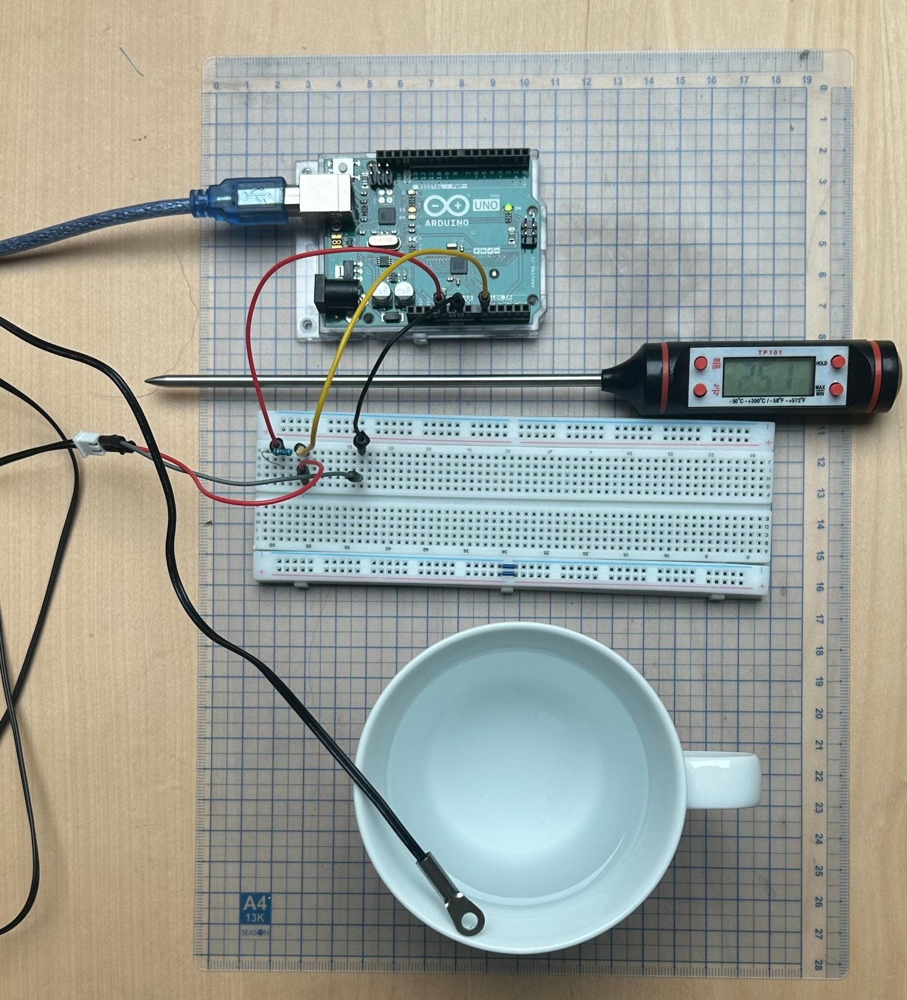
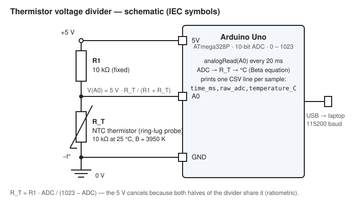
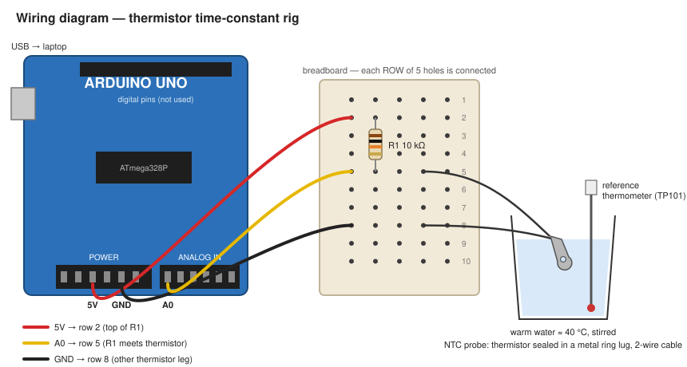
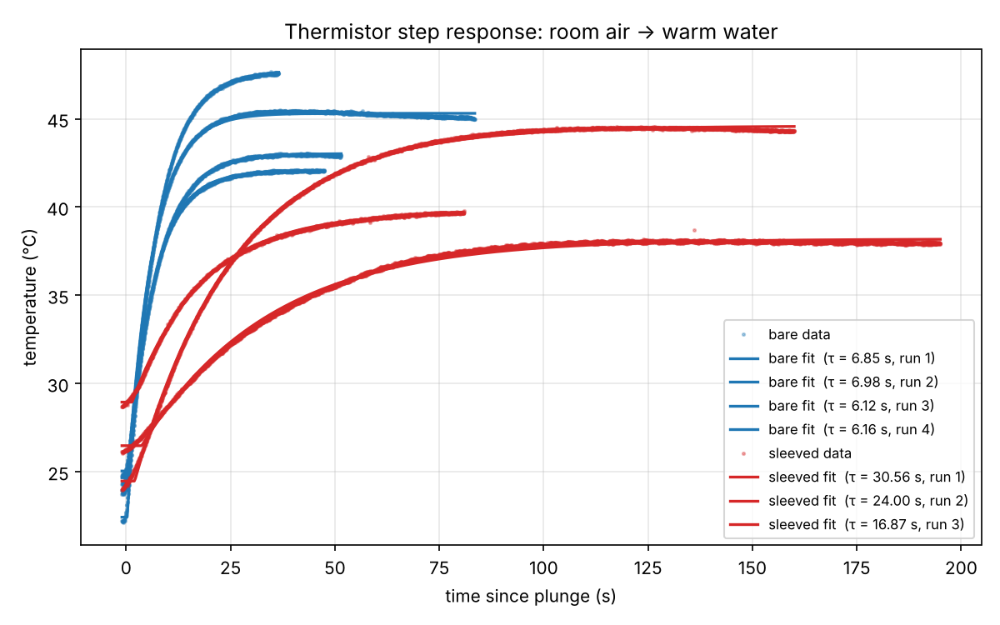
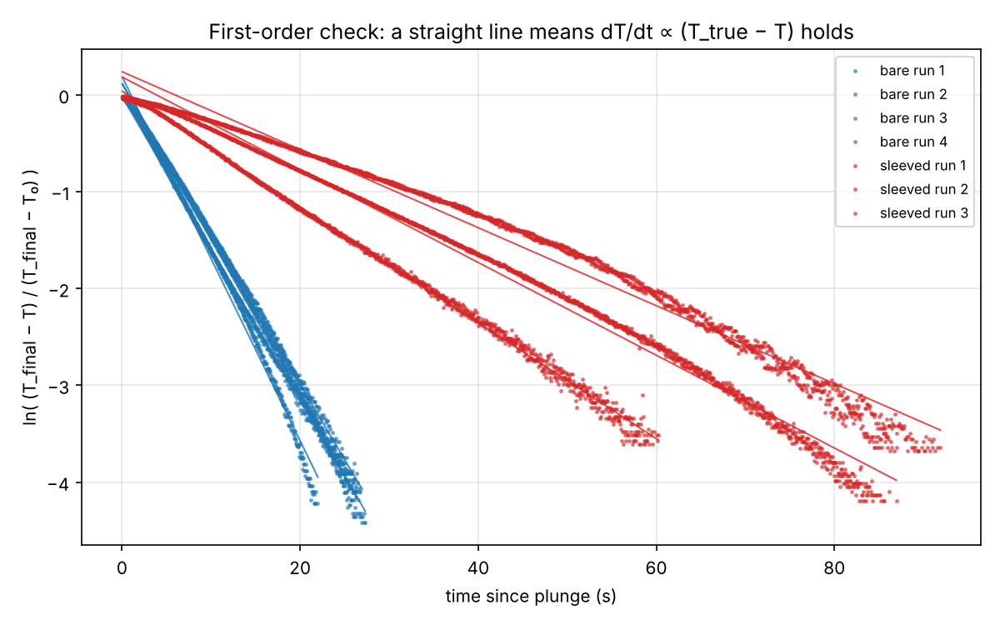

# How fast does a temperature sensor actually respond?

**Measuring the time constant of an NTC thermistor probe with an Arduino — bare, and inside a plastic sleeve.**

Abdon Philip Beitia Tsang · Terminale (Bac BFI), Lycée International de Saint-Germain-en-Laye · October 2026

> This is a small characterisation of one sensor on my desk, not research. Every number quoted in my university application comes from the files in this repo.

---

## Aim

Find out how long a cheap NTC thermistor probe takes to catch up with a sudden temperature change, and how much a thin plastic sleeve (like the probe cover on a clinical thermometer) slows it down. Report the time constant τ for both cases, with an honest uncertainty.

## Why I did this

In physics we solved the equation for a body falling through a viscous fluid: weight, Archimedes' buoyancy and a drag force proportional to speed give

    dv/dt = A − B·v

which we solved as a `y' = ay + b` equation. The speed never jumps to its final value; it creeps up to a terminal velocity `A/B` with a time constant `1/B`.

A temperature sensor behaves the same way. Heat flows into it at a rate proportional to the gap between the true temperature and the sensor's own temperature (Newton's law of heating), so

    dT/dt = (T_true − T)/τ        i.e.   dT/dt = A − B·T   with   A = T_true/τ   and   B = 1/τ

Same equation, different letters. The "terminal velocity" is `A/B = T_true` — where the reading ends up — and the time constant is `1/B = τ`.

| | Falling body | Temperature sensor |
|---|---|---|
| equation | `dv/dt = A − B·v` | `dT/dt = A − B·T` |
| what `A` is | (weight − buoyancy) / mass | `T_true / τ` |
| what `B` is | drag coefficient / mass | `1/τ` |
| final value `A/B` | terminal velocity | the true temperature |
| time constant `1/B` | how long the speed takes to settle | how long the reading takes to settle |
| solution | `v = A/B − (A/B − v₀)·e^(−Bt)` | `T = T_true − (T_true − T₀)·e^(−t/τ)` |

After one τ the reading has covered 63 % of the gap. After 5τ it has covered 99.3 % — basically arrived. So τ is the one number that says whether a sensor is fast enough for a job. I wanted to measure it myself rather than read it off a datasheet.

## The set-up



**Parts**

| part | what I used |
|---|---|
| microcontroller | Arduino Uno (ATmega328P, 10-bit ADC) |
| sensor | NTC thermistor probe, 10 kΩ at 25 °C, no-name — the thermistor is sealed inside a flat metal ring lug on a 2-wire cable. Beta taken as 3950 K (the usual value for these; I didn't have a datasheet, see Limitations) |
| fixed resistor | 10 kΩ, ¼ W (nominal — not measured, see Limitations) |
| reference thermometer | TP101 digital kitchen probe (stated accuracy ±1 °C) |
| sleeve | thin plastic wrap (~0.5 mm) wrapped round the lug with some air trapped inside — not re-fitted between runs |
| water | a mug of warm tap water, 38–48 °C, stirred with a spoon during the runs |

**Circuit** — a voltage divider. The fixed resistor and the thermistor share the 5 V, so the Arduino's reading is a ratio and the exact supply voltage doesn't matter.





From the ADC value (0–1023) the thermistor's resistance is `R_T = R1 · ADC / (1023 − ADC)`, and the Beta equation turns that into kelvin:

    1/T = 1/298.15 + (1/B) · ln(R_T / 10 kΩ)

The code is in [`arduino/thermistor_tau/thermistor_tau.ino`](arduino/thermistor_tau/thermistor_tau.ino). It samples every 50 ms (20 Hz), averages 8 ADC reads per sample to cut noise, and prints `time_ms,raw_adc,temperature_C` over USB. On the laptop I saved the stream to a file with one PowerShell line (in [`tools/README.md`](tools/README.md)); `tools/serial_logger.html` is a browser alternative.

## Method

1. Plug in the Arduino, start logging to a CSV.
2. Leave the probe in room air until the reading is flat for at least 15 s. That's `T₀`.
3. Stir the warm water, read the TP101 (`T_true`), then plunge the probe in — straight in, lug fully under, held still, not touching the mug or the spoon.
4. Keep logging until the reading has been flat for ~20 s. Stop. Lift the probe out and let it cool back towards room temperature.
5. Repeat → `bare_run1..4.csv` (I did four).
6. Wrap the probe in the plastic sleeve and do three more → `sleeved_run1..3.csv`. These take 2–3 minutes each.
7. Run `python analysis/fit_tau.py data/*.csv`. For each run it finds τ three ways:
   * **63 % rule** — time from the plunge until the reading has covered 63.2 % of the gap. No fitting, just reading the data.
   * **Least-squares fit** of `T = T_∞ − (T_∞ − T₀)·e^(−(t−t₀)/τ)` (all four parameters free).
   * **Straight-line check** — plot `ln((T_∞ − T)/(T_∞ − T₀))` against time. If the equation above is right, this is a straight line with slope `−1/τ`. If it bends, the sensor isn't a simple first-order system.

The same analysis done by hand in a spreadsheet is in [`analysis/spreadsheet_method.md`](analysis/spreadsheet_method.md).

## Results

| Run | T₀ air (°C) | TP101 water (°C) | sensor plateau (°C) | τ 63 % (s) | τ fit (s) | τ line (s) | line R² |
|---|---|---|---|---|---|---|---|
| bare 1 | 22.4 | 48.0 | 47.5 | 6.99 | 6.85 | 6.18 | 0.997 |
| bare 2 | 24.9 | 43.0 | 42.9 | 7.28 | 6.98 | 6.44 | 0.998 |
| bare 3 | 24.5 | 45.0 | 45.1 | 6.42 | 6.12 | 5.32 | 0.993 |
| bare 4 | 23.8 | 42.2 | 42.0 | 6.26 | 6.16 | 6.36 | 0.999 |
| sleeved 1 | 25.9 | 38.6 | 38.0 | 32.98 | 30.56 | 24.83 | 0.982 |
| sleeved 2 | 24.0 | 44.5 | 44.4 | 25.08 | 24.00 | 20.88 | 0.992 |
| sleeved 3 | 28.5 | 40.3 | 39.6 | 17.09 | 16.87 | 16.71 | 0.998 |

(Full output: [`analysis/results.md`](analysis/results.md), [`analysis/results.csv`](analysis/results.csv).)

**τ (bare) = 6.5 ± 0.5 s** (mean ± SD of 4 runs; range 6.1–7.0 s)
**τ (sleeved) = 24 ± 7 s** (mean ± SD of 3 runs; range 17–31 s)

**The sleeve made the sensor 3.6 ± 1.1× slower.** In practical terms: a reading you can trust (5τ) takes about 30 s bare and about 2 minutes with the sleeve on.

Three things I noticed in the numbers:

* **τ doesn't depend on the size of the temperature step.** The bare runs went from 18 °C to 25 °C jumps and gave the same τ within 7 %. That is exactly what `dT/dt = (T_true − T)/τ` predicts — the rate is proportional to the gap, so the *shape* of the curve is the same whatever the gap. Good to see it rather than just assume it.
* **The sensor agrees with the thermometer.** Every plateau was within 0.7 °C of the TP101 reading, which is inside the thermometer's own ±1 °C. So the guessed Beta value is fine — and in any case τ comes from the shape of the curve, not from the absolute temperature (I checked this in the fit script's self-test with a deliberately mis-calibrated curve: τ moved by 0.3 %).
* **The sleeved τ fell every run: 31 → 24 → 17 s.** I didn't re-wrap the sleeve between runs. After the first plunge there was condensation inside it and the film had settled closer onto the lug — less trapped air, thinner insulating gap, faster response. The sleeve's time constant is not a property of the sleeve alone; it depends on how it is fitted and whether it is dry. The straight-line check agrees: run 1 (most air) bends the most at the start; run 3 (least air) is almost perfectly straight.





## Uncertainty

* **Run-to-run spread** is the main uncertainty, so I quote the standard deviation of the repeats and the min–max range (four or three points don't make a very good standard deviation, so the range matters).
* The **fit's own standard error** on τ is 0.01–0.07 s (in `results.csv`) — far smaller than the run-to-run spread. The scatter comes from the experiment (plunge speed, stirring, sleeve fit), not from the maths.
* The **sleeve factor** `τ_sleeved / τ_bare` gets its uncertainty by adding the two relative uncertainties in quadrature: 3.6 × √((7/24)² + (0.5/6.5)²) ≈ 1.1.
* The **63 % method** depends on choosing the plunge instant to within one sample (50 ms) — under 1 % of the bare τ. It gives τ 2–8 % higher than the curve fit every time, because the plunge isn't a perfect step (see Limitations); the curve fit absorbs this by fitting `t₀`.
* The **straight-line method** gives τ about 10 % lower than the fit for the bare runs. It weights the early seconds most, where the real curve bends slightly (the plunge takes ~0.2 s and the sensor meets the surface before it is fully under). The three methods bracket the answer; I quote the curve fit.

## Limitations (things I know are not perfect)

1. **The model is first-order; the sensor isn't quite.** A thermistor chip sealed in a metal lug is a chain of thermal masses (metal → potting → chip), so the true response is a sum of exponentials. The straight-line check shows the single-τ approximation is very good for the bare probe (R² ≥ 0.993) and rougher for the sleeved one (R² 0.982 with the most air), because the air pocket adds a second stage in series.
2. **τ is not a property of the sensor alone.** It depends on how fast heat reaches the surface: stirred water, still water and air give very different τ for the same probe. My numbers are for *stirred water at 38–48 °C*, nothing else.
3. **The sleeve was not re-fitted between repeats.** The three sleeved values are one wrap degrading (condensation, film settling), not three independent fits. A fresh wrap per run would separate fit-to-fit variation from degradation of a single fit — that's the obvious next experiment.
4. **The plunge isn't an instant step.** My hand takes ~0.1–0.2 s, and the lug meets the surface before it is fully immersed.
5. **The water cools during a run** — about 0.4–0.5 °C/min in the long sleeved runs. I fit the final temperature instead of assuming it, and I compared it to the TP101 read at the start.
6. **Sleeved run 3 started warm** (28.5 °C) because the wrapped probe hadn't cooled fully from run 2. This changes the step size, not τ (see Results).
7. **Self-heating.** The divider puts about 0.6 mW into the thermistor. In still air that can warm a bare bead by a few tenths of a degree; for a metal lug in water it is negligible. It affects `T₀` slightly, not τ.
8. **ADC resolution.** One ADC step is about 0.1 °C in this range; averaging 8 reads helps the noise but not the step size. There is also a ±0.05 °C flicker between alternate samples — 50 Hz mains pickup on the long sensor cable.
9. **Reference thermometer.** A TP101 is ±1 °C, and it has its own (unknown) time constant — which is exactly the problem this project is about. It only affects the `T_true` comparison, not τ.
10. **Beta value and fixed resistor** were assumed (3950 K, 10.0 kΩ), not measured. A wrong Beta shifts the reading by 1–2 °C at 40 °C; a resistor off by 1 % shifts it by ~0.1 °C. The plateau-vs-TP101 agreement suggests both are close. Again: affects the reading, not τ.
11. **Heat conduction along the cable** — the wires carry heat too, so immersion depth matters. I kept it the same each run.
12. **Only 4 + 3 repeats.**

## What this means for medical sensors

A reading is only useful if the sensor gets there before the thing it's measuring has moved on. Two places where the time constant is the whole story:

* **Predictive clinical thermometers.** A digital thermometer that beeps after ~10–30 s hasn't actually reached body temperature — it is solving my equation backwards: it watches the start of the curve, estimates τ and `T_true`, and reports `T_true` before the sensor arrives. The disposable probe cover is part of the design. My sleeved runs show a cover changes τ by a factor of ~3.6, and that a loose or damp cover has a different τ from a fresh one — so the thermometer's prediction only works for the cover it was calibrated with, fitted properly.
* **Thermodilution catheters (cardiac output).** A tiny thermistor on the tip of a pulmonary-artery catheter records the few-seconds-long temperature dip when cold saline passes; cardiac output comes from the area under that curve. A sensor with a τ comparable to the curve's width would smear it and get the answer wrong, so these thermistors have to be far faster than my 6.5 s lug — and they are bare and in flowing blood, exactly the "fast" conditions of my bare runs.
* Also: **incubator and radiant-warmer servo control** (a skin probe drives the heater — a slow sensor makes the control loop overshoot) and **ventilator humidifier airway sensors** (gas temperature changes every breath).

## Repo layout

```
README.md
arduino/thermistor_tau/thermistor_tau.ino   sketch — 20 Hz CSV over serial
tools/README.md                              how I saved the serial stream (PowerShell one-liner)
tools/serial_logger.html                     browser logger (Chrome/Edge) — alternative to the one-liner
analysis/fit_tau.py                          63 % rule, curve fit, straight-line check, repeat stats, plots
analysis/spreadsheet_method.md               the same analysis by hand in a spreadsheet
analysis/results.csv, results.md             numbers (generated by fit_tau.py)
analysis/fig_T_vs_t.png, fig_log_check.png   plots (generated by fit_tau.py)
data/bare_run1..4.csv, sleeved_run1..3.csv   raw logs, untouched (see data/README.md)
docs/photo_rig.jpg, schematic.svg, wiring.svg
```

To reproduce: `pip install -r analysis/requirements.txt`, then `python analysis/fit_tau.py data/*.csv`. To check the analysis method without hardware: `python analysis/fit_tau.py --selftest` (fits fake data with a known τ; it recovers it to within 0.1 %).

---

Abdon Philip Beitia Tsang · 27 October 2026 · Saint-Germain-en-Laye, France
